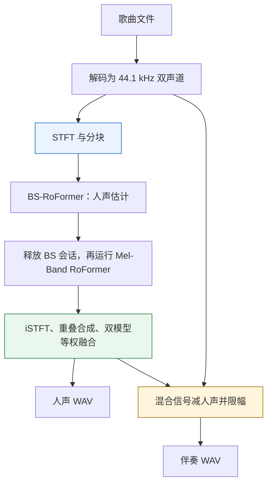

<h1 align="center">UARMusic</h1>
<p align="center">本地人声与伴奏分离 · Windows 原生桌面应用</p>
<p align="center">
  
  
  
  
</p>
<p align="center">
  <a href="https://github.com/wed957/music-separation/releases">下载</a> · <a href="#分离架构">架构</a> · <a href="#从源码构建">构建</a> · <a href="docs/models.md">模型溯源</a> · <a href="#维护与-agent-接手">维护接手</a>
</p>

---

将歌曲分离为人声和伴奏两条 WAV，输入解码、模型推理和试听均在本机完成。界面使用原生 Win32，音频由 miniaudio 与 Windows Media Foundation 处理，分离核心使用两套 ONNX 模型。

<p align="center">
  
</p>
<p align="center"><a href="docs/images/app.png">查看深色界面</a></p>

## 使用

从 [Releases](https://github.com/wed957/music-separation/releases) 下载 Windows x64 完整包，解压后运行 `UARMusic.exe`，选择歌曲目录与输出目录。处理完成后可试听人声与伴奏。

| 项目 | 当前行为 |
| --- | --- |
| 直接解码 | MP3、FLAC、WAV |
| NCM | 本地解码后分离，中间文件位于 `.ncm_decoded` |
| 其他格式 | 取决于 Windows Media Foundation 解码器 |
| 最大时长 | 单首 15 分钟 |
| 输出规格 | 44.1 kHz、双声道、32 位浮点 WAV |
| 输出命名 | `<歌名>_vocals.wav`、`<歌名>_instrumental.wav` |
| 计算后端 | CPU，无 CUDA 执行提供程序 |

> 不同目录下的同名歌曲会映射到同名输出，原目录层级不会保留。批量处理前请检查重名，并使用独立输出目录。源歌曲不被改写。

## 分离架构



```text
vocals       = 0.5 * BS(mixture) + 0.5 * Mel(mixture)
instrumental = clamp(mixture - vocals, -1.0, 1.0)
```

两套模型串行创建和释放，避免同时常驻内存。两条路径分别预测人声复数频谱掩码，经过逆变换与分块合成后，在时域等权融合；伴奏由混合信号减去人声得到。

| 模型 | 当前形式 | 作用 |
| --- | --- | --- |
| BS-RoFormer | opset 18，动态 uint8 量化，约 159.8M 参数 | 第一份人声估计 |
| Mel-Band RoFormer | opset 17，float32，33,666,916 个权重与常量值 | 第二份人声估计 |

论文、上游检查点、转换来源、张量核对记录、FFT 参数与输入输出形状见 [模型与推理参考](docs/models.md)。检查点名称中的 SDR 是上游发布标记，不是本应用的实测指标，也不保证所有歌曲具有相同效果。

## 技术与目录

| 路径 | 技术与职责 |
| --- | --- |
| [src/main.cpp](src/main.cpp) | Win32 窗口、任务状态、文件列表与交互 |
| [src/audio_engine.cpp](src/audio_engine.cpp) | miniaudio、Media Foundation、音频解码与试听 |
| [src/separation_engine.cpp](src/separation_engine.cpp) | ONNX Runtime、频谱变换、模型调度、融合与输出 |
| [src/lucide_icons.h](src/lucide_icons.h) | 本地图标 |
| [CMakeLists.txt](CMakeLists.txt) | C++17 构建、模型校验与安装目录 |
| [models/](models/) | Git LFS 管理的两套 ONNX 权重 |
| [third_party/](third_party/) | 音频、推理运行时与许可材料 |
| [testdata/in/sample.wav](testdata/in/sample.wav) | 人工冒烟验证样例 |

## 从源码构建

需要 Windows x64、CMake 3.20+、Ninja、MinGW-w64 和 Git LFS。克隆时必须取回模型大文件：

```powershell
git clone https://github.com/wed957/music-separation.git
cd music-separation
git lfs install
git lfs pull
cmake -S . -B build -G Ninja -DCMAKE_BUILD_TYPE=Release
cmake --build build --parallel
cmake --install build --prefix dist/UARMusic-win-x64
```

CMake 配置阶段核对模型大小和 SHA-256；LFS 指针、缺失 DLL 或错误权重会导致配置失败。模型校验以 [CMakeLists.txt](CMakeLists.txt) 为准，不要仅修改校验值来绕过错误。

需要外部依赖位置时，使用以下 CMake 缓存参数：

| 参数 | 指向 |
| --- | --- |
| `UAR_ORT_ROOT` | ONNX Runtime 1.20.1 Windows x64 SDK |
| `UAR_BS_MODEL_FILE` | 完整 BS ONNX 文件 |
| `UAR_MEL_MODEL_FILE` | 完整 Mel ONNX 文件 |

安装目录必须包含 EXE、`onnxruntime.dll`、`onnxruntime_providers_shared.dll`、`models/` 和许可材料。完整包约 315 MB，约 2 MB 的 EXE 不能单独完成推理。

## 验证与排障

当前仓库没有独立的自动化测试套件；构建成功不能替代音频结果验收。维护推理代码后，应使用 [样例](testdata/in/sample.wav) 核对两条输出的时长、采样率、声道、有限采样值，再试听与检查取消、批量、重名和错误输入行为。

| 现象 | 优先检查 |
| --- | --- |
| 程序无法启动 | DLL 是否与 EXE 一起解压，是否使用 x64 Windows |
| CMake 提示模型不完整 | Git LFS 是否完成下载，模型路径和哈希是否正确 |
| 文件无法处理 | 实际编码是否可解码，必要时先转 WAV |
| 歌曲太长 | 先裁剪至 15 分钟以内 |
| 输出被覆盖 | 是否存在不同目录下的同名输入 |
| 分离较慢 | 当前使用 CPU，长歌曲和两套模型需要更多时间 |

## 维护与 Agent 接手

先读本页、[模型参考](docs/models.md) 与 [第三方说明](THIRD_PARTY_NOTICES.md)，再按界面、解码、推理三个层次定位代码。

推理变更应核对采样布局、STFT/iSTFT、模型固定形状、分块边界和释放顺序；`segmentSize` / `batchSize` 是保留的兼容字段，不应当作当前有效调参入口。替换权重时同步来源记录、哈希、张量形状和 CMake 打包契约。

歌曲在本机处理；获取源码、模型和发行包仍需要网络。代码、模型权重和训练素材各自有许可边界，详见 [THIRD_PARTY_NOTICES.md](THIRD_PARTY_NOTICES.md)，不要把上游训练素材默认视为可再分发资源。
