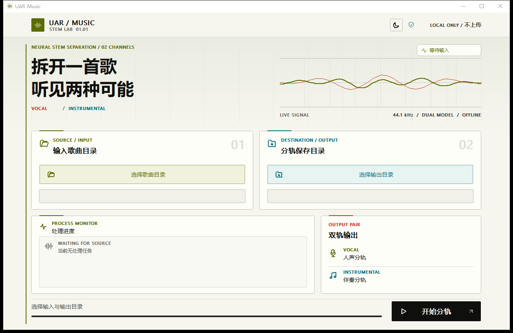

# UAR Music

UAR Music 是一个面向普通用户的 Windows 歌曲处理工具。它把一首歌保存成两份：

- **唱歌声**：主要保留人声
- **音乐声**：主要保留乐器和背景音乐

程序只在本机处理文件，不上传歌曲，也不会修改原文件。界面只保留“选择歌曲目录、选择输出目录、开始分轨”三个步骤，并支持黑白主题即时切换。



<details>
<summary>查看暗色界面</summary>


</details>

## 功能

- 原生支持 `.ncm`、`.wav`、`.mp3`、`.flac`
- 通过 Windows Media Foundation 支持 AAC、M4A、MP4、WMA、AIFF、OGG/Opus 等系统可解码格式，不捆绑大型解码库
- 自动扫描所选文件夹及其子文件夹
- 每首歌生成 `_唱歌声.wav` 和 `_音乐声.wav`
- 内置两套离线处理文件，它们会一个接一个完成工作，再把两次结果合到一起；正式发布包无需额外下载
- 支持 Windows 高分辨率屏幕和 4K / 200% 显示缩放
- 支持暗色与亮色界面即时切换
- 可在处理过程中停止任务

## 下载和使用

完整 Windows 发布包放在 [GitHub Releases](https://github.com/wed957/music-separation/releases)。下载 `UARMusic-win-x64.zip` 并完整解压，不要只单独复制 `UARMusic.exe`。

1. 双击 `UARMusic.exe`。
2. 点击“选择歌曲目录”。
3. 点击“选择输出目录”。
4. 点击“开始分轨”。

输出文件示例：

```text
歌曲名_唱歌声.wav
歌曲名_音乐声.wav
```

## 发布包结构

```text
UARMusic-win-x64/
├── UARMusic.exe
├── onnxruntime.dll
├── onnxruntime_providers_shared.dll
├── THIRD_PARTY_NOTICES.md
├── licenses/
│   ├── onnxruntime/
│   │   ├── LICENSE
│   │   └── ThirdPartyNotices.txt
│   └── lucide/
│       └── LICENSE
└── models/
    ├── bs_roformer_quantized.onnx
    └── mel_band_roformer_vocals.onnx
```

完整运行目录约 `315 MB`（约 `300 MiB`）。两份内置文件的信息如下：

界面与格式兼容层不捆绑浏览器、FFmpeg 或额外编解码 DLL；MinGW Release 可执行文件约 `2 MB`，新增格式由 Windows 系统组件解码。完整包体积仍主要来自约 `300 MiB` 的两套离线分轨模型，这是保持离线双模型质量的必要成本。

| 文件 | 大小 | SHA-256 |
| --- | ---: | --- |
| `bs_roformer_quantized.onnx` | `165,858,657` 字节（约 `165.9 MB`） | `B86B6224FF34D6D34C2530E0D41495B6A2C12DB46ACC1A7A5C7F64D2352807E9` |
| `mel_band_roformer_vocals.onnx` | `135,441,533` 字节（约 `135.4 MB`） | `BD42C4B3339F43B41BACEB2A0204C941744F43911A47F006DF5B62E560F91CC1` |

## 源码目录

```text
UARMusic/
├── src/                     # Win32 界面、音频读写和歌曲处理
├── resources/               # 应用清单和 Windows 资源
├── third_party/             # miniaudio 和裁剪后的 ONNX Runtime SDK
├── models/                  # 通过 Git LFS 保存内置模型
├── testdata/                # 简短的本地冒烟测试音频
├── CMakeLists.txt
├── THIRD_PARTY_NOTICES.md
└── README.md
```

构建目录、下载缓存、完整 ONNX Runtime 调试包和发布包均由 `.gitignore` 排除。仓库只保留约 12 MB 的最小 ONNX Runtime 构建文件；当前使用的两份模型通过 Git LFS 跟踪，旧模型和实验文件不会提交。

## 开发者构建

### 环境要求

- Windows 10 或 Windows 11 x64
- CMake `3.20+`
- Ninja
- 支持 C++17 的 MinGW-w64 工具链
- Git LFS `3.x`

仓库已经包含 `third_party/miniaudio.h` 和 ONNX Runtime `1.20.1` 的最小 Windows x64 SDK，模型保存在 Git LFS 中。克隆后先确认大文件已经拉取：

```powershell
git lfs install
git lfs pull
```

### 编译

默认使用仓库内的 ONNX Runtime、`models/bs_roformer_quantized.onnx` 和 `models/mel_band_roformer_vocals.onnx`，无需填写本机依赖路径。程序会串行执行两个模型，并在波形层融合两次处理结果，避免两个模型同时常驻内存：

```powershell
cmake -S . -B build -G Ninja `
  -DCMAKE_BUILD_TYPE=Release

cmake --build build --parallel
```

程序和运行所需文件会自动复制到：

```text
build/bin/
```

也可以生成独立发布目录：

```powershell
cmake --install build --prefix dist/UARMusic-win-x64
```

需要替换依赖时，可以额外传入以下参数：

- `-DUAR_ORT_ROOT=<SDK目录>`
- `-DUAR_BS_MODEL_FILE=<BS模型文件>`
- `-DUAR_MEL_MODEL_FILE=<Mel模型文件>`

如果缺少头文件、DLL、导入库或任一模型，CMake 会在配置阶段给出明确错误。

## 验证情况

- Release 构建通过，编译器警告已启用：`-Wall -Wextra -Wpedantic`
- 已在 `1000x720` 和 `2520x1640` 窗口尺寸下检查界面
- 已检查暗色、亮色以及 `1000x720` 最小窗口下的完整布局
- 已用 M4A 样本验证 Windows Media Foundation 解码、重采样和双声道转换
- 已用 `testdata/in/sample.wav` 完成真实处理
- 输出为 `44.1 kHz`、双声道、32 位浮点 WAV，时长与输入一致

## 隐私和使用边界

- 程序不联网，不上传歌曲
- AAC、M4A、MP4、WMA、AIFF、OGG/Opus 等扩展格式取决于当前 Windows 提供的系统解码器；受 DRM 保护的文件不在支持范围内
- 原歌曲不会被覆盖
- NCM 解包只用于用户本人有权访问的本地文件
- 项目不提供受保护内容的分发能力
- 模型属于第三方训练资产，使用和再分发前应确认其来源与许可

第三方组件和许可说明见 [THIRD_PARTY_NOTICES.md](THIRD_PARTY_NOTICES.md)。
