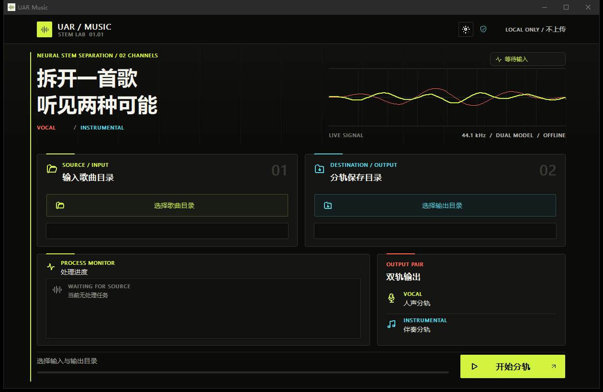

# Music Separation (UARMusic)

Music Separation 是一款面向 Windows 的离线人声与伴奏分离工具。选择歌曲目录和输出目录后，程序会递归扫描歌曲，并为每首歌曲生成一份人声轨和一份伴奏轨。

- 全程本地处理，不上传歌曲
- 默认亮色界面，可在右上角切换暗色界面
- 使用两套 Roformer ONNX 模型串行推理并融合结果
- 原生 Win32 界面，程序本体约 `2 MB`
- 输入文件不会被修改

> 当前版本只提供 Windows x64 构建。音频分离需要较多计算时间和内存，实际速度取决于处理器、歌曲长度及可用内存。


<details>
<summary>查看暗色界面</summary>



</details>

## 下载与使用

从 [GitHub Releases](https://github.com/wed957/music-separation/releases) 下载 `UARMusic-win-x64.zip`，完整解压后运行 `UARMusic.exe`。不要只复制可执行文件，程序还需要同目录中的 ONNX Runtime 动态库和 `models` 目录。

1. 点击“选择歌曲目录”，选择包含歌曲的文件夹。
2. 点击“选择输出目录”，选择用于保存分轨结果的文件夹。
3. 点击“开始分轨”。程序会扫描输入目录及其所有子目录。
4. 在处理记录中查看进度。处理期间可点击同一按钮停止任务。

建议让输入目录和输出目录彼此独立。若输出目录位于输入目录内，后续再次扫描时可能把之前生成的 WAV 文件当作新输入。

## 支持的音频格式

程序按扩展名扫描以下文件：

| 类型 | 扩展名 | 解码方式 |
| --- | --- | --- |
| NCM | `.ncm` | 本地解包后按 MP3 或 FLAC 解码 |
| 常用音频 | `.wav`、`.wave`、`.mp3`、`.flac` | 内置解码器，失败时尝试系统解码器 |
| MPEG-4 / AAC | `.aac`、`.m4a`、`.m4b`、`.mp4` | Windows Media Foundation |
| Windows Media | `.wma` | Windows Media Foundation |
| AIFF | `.aif`、`.aiff` | Windows Media Foundation |
| Ogg / Opus | `.ogg`、`.oga`、`.opus` | Windows Media Foundation |
| 其他已扫描格式 | `.alac`、`.ape`、`.ac3`、`.amr`、`.mka` | Windows Media Foundation |

“已扫描”不代表任意 Windows 环境都一定能够解码。除 WAV、MP3、FLAC 和 NCM 内嵌的 MP3/FLAC 外，其余格式取决于当前 Windows 版本、系统组件、文件容器和实际编码。以下文件不保证可用：

- 受 DRM 保护或需要在线授权的文件
- 内容损坏、扩展名与真实编码不一致的文件
- 系统没有对应解码器的扩展格式
- 使用非标准封装或特殊编码参数的文件

兼容性优先时，建议先将歌曲转换为 WAV、MP3 或 FLAC。NCM 功能仅用于用户本人有权访问的本地文件。

## 输出与限制

每首歌曲默认生成两个文件：

```text
歌曲名_唱歌声.wav
歌曲名_音乐声.wav
```

输出规格固定为：

| 项目 | 规格 |
| --- | --- |
| 采样率 | `44.1 kHz` |
| 声道 | 双声道 |
| 格式 | `32` 位浮点 WAV |
| 单首最大长度 | `15` 分钟 |

需要注意：

- 程序不会覆盖输入歌曲。
- 再次处理同名歌曲时，同名输出 WAV 可能被替换。
- 输入目录中的子目录结构不会复制到输出目录。不同子目录里具有相同文件名的歌曲会产生同名输出，请分批处理或使用不同输出目录。
- NCM 解包产生的中间文件保存在输出目录的 `.ncm_decoded` 子目录。
- 两份浮点 WAV 的体积通常明显大于原始压缩音频，请预留足够磁盘空间。

## 发布包

完整运行目录约 `315 MB`，其中 `UARMusic.exe` 约 `2 MB`。主要体积来自两套内置分离模型，而不是界面或解码组件。

```text
UARMusic-win-x64/
|-- UARMusic.exe
|-- onnxruntime.dll
|-- onnxruntime_providers_shared.dll
|-- THIRD_PARTY_NOTICES.md
|-- licenses/
|   |-- lucide/
|   `-- onnxruntime/
`-- models/
    |-- bs_roformer_quantized.onnx
    `-- mel_band_roformer_vocals.onnx
```

模型文件校验信息：

| 文件 | 大小 | SHA-256 |
| --- | ---: | --- |
| `bs_roformer_quantized.onnx` | `165,858,657` 字节 | `B86B6224FF34D6D34C2530E0D41495B6A2C12DB46ACC1A7A5C7F64D2352807E9` |
| `mel_band_roformer_vocals.onnx` | `135,441,533` 字节 | `BD42C4B3339F43B41BACEB2A0204C941744F43911A47F006DF5B62E560F91CC1` |

## 从源码构建

### 环境要求

- Windows 10 或 Windows 11 x64
- CMake `3.20` 或更高版本
- Ninja
- 支持 C++17 的 MinGW-w64 工具链
- Git LFS

仓库包含 miniaudio、Lucide 图标数据和裁剪后的 ONNX Runtime `1.20.1` Windows x64 SDK。两套模型通过 Git LFS 管理。

### 获取模型并编译

在仓库根目录运行：

```powershell
git lfs install
git lfs pull

cmake -S . -B build -G Ninja `
  -DCMAKE_BUILD_TYPE=Release
cmake --build build --parallel
```

构建完成后，可直接运行：

```text
build/bin/UARMusic.exe
```

生成独立发布目录：

```powershell
cmake --install build --prefix dist/UARMusic-win-x64
```

### 自定义依赖路径

CMake 支持以下缓存参数：

| 参数 | 用途 |
| --- | --- |
| `UAR_ORT_ROOT` | ONNX Runtime Windows x64 SDK 根目录 |
| `UAR_BS_MODEL_FILE` | BS Roformer 模型文件路径 |
| `UAR_MEL_MODEL_FILE` | Mel-band Roformer 模型文件路径 |

示例：

```powershell
cmake -S . -B build -G Ninja `
  -DCMAKE_BUILD_TYPE=Release `
  -DUAR_ORT_ROOT=C:/sdk/onnxruntime `
  -DUAR_BS_MODEL_FILE=D:/models/bs_roformer_quantized.onnx `
  -DUAR_MEL_MODEL_FILE=D:/models/mel_band_roformer_vocals.onnx
```

模型参数用于改变文件位置，不表示支持任意 ONNX 模型。配置阶段会严格检查上表中的文件大小和 SHA-256；文件不匹配时构建会停止。自定义 ONNX Runtime 目录必须包含：

```text
include/onnxruntime_cxx_api.h
lib/onnxruntime.lib
bin/onnxruntime.dll
bin/onnxruntime_providers_shared.dll
```

官方 SDK 若把 DLL 放在 `lib` 目录，构建脚本也会自动识别。

## 项目结构

```text
music-separation/
|-- src/                     # Win32 界面、音频解码和分离引擎
|-- resources/               # Windows 资源与应用清单
|-- models/                  # Git LFS 管理的 ONNX 模型
|-- third_party/             # miniaudio、Lucide 许可和 ONNX Runtime SDK
|-- docs/images/             # README 界面截图
|-- testdata/                # 本地冒烟测试音频
|-- CMakeLists.txt
|-- THIRD_PARTY_NOTICES.md
`-- README.md
```

核心模块：

- `src/main.cpp`：窗口、主题、目录选择、任务调度和进度界面
- `src/audio_engine.cpp`：目录扫描、音频解码、重采样、NCM 解包和 WAV 写入
- `src/separation_engine.cpp`：双模型推理、分块、融合和双轨生成
- `src/lucide_icons.h`：界面统一使用的 Lucide 矢量图标

## 隐私与使用边界

- 分离过程在本机完成，程序不会上传歌曲。
- 程序不会修改原始输入文件。
- 项目不提供受保护内容的分发能力。
- 使用 NCM、本地歌曲和分离结果时，请确保拥有相应访问权和使用权。
- 模型属于第三方训练资产，使用、再分发或商业发布前请确认其来源与许可条件。

第三方组件及许可信息见 [THIRD_PARTY_NOTICES.md](THIRD_PARTY_NOTICES.md)。

## 故障排查

### 程序无法启动

确认已完整解压发布包，且 `UARMusic.exe`、两个 ONNX Runtime DLL 和 `models` 目录保持原有相对位置。当前构建仅支持 Windows x64。

### 找到了歌曲但无法处理

先用 WAV、MP3 或 FLAC 文件验证。对于 AAC、M4A、WMA、Ogg、Opus 等扩展格式，失败通常表示 Windows Media Foundation 无法解码该文件；可先用可信的音频工具转为 WAV 或 FLAC。受 DRM 保护的文件无法处理。

### 提示歌曲太长

单首歌曲解码后的长度上限为 15 分钟。请先裁剪或分段后再处理。

### CMake 提示模型不完整

确认 Git LFS 已安装，并重新拉取模型：

```powershell
git lfs install
git lfs pull
git lfs ls-files
```

若问题仍存在，请用 `Get-FileHash -Algorithm SHA256 <模型路径>` 与本文的校验值比较。

### 输出文件互相覆盖

程序按输入文件的基础名称生成输出，不保留输入目录层级。把同名歌曲分批放入不同输入目录，或为每批任务选择不同输出目录。
